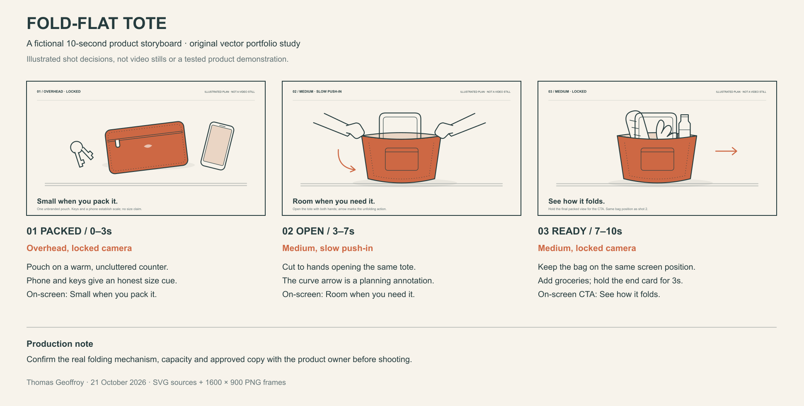

# Fold-flat tote — three-shot storyboard

An original, self-initiated vector study by Thomas Geoffroy, 21 October 2026. The unbranded product is fictional. This is a portfolio piece, not commissioned work, a photographed product, a video output, or a tested capacity/folding claim. No stock images, traced artwork, real logos or recognisable people are used.

The sequence establishes the folded product's scale with everyday objects, cuts to it opening, then holds a packed view for the call to action. Shots 2 and 3 keep the tote in the same position to make the result easy to read. The curved arrow is a planning annotation, not an object in the finished video.

The plan uses a fictional ten-second runtime. A real commission would first confirm the product facts, folding mechanism, reference assets, approved copy and aspect ratio. Timing and movement would then follow that brief.

## Files

| Shot | PNG preview, 1600 × 900 | Editable vector source |
|---|---|---|
| 1 — packed / overhead | [PNG](01-packed.png) | [SVG](01-packed.svg) |
| 2 — open / medium push-in | [PNG](02-open.png) | [SVG](02-open.svg) |
| 3 — ready / medium locked | [PNG](03-ready.png) | [SVG](03-ready.svg) |

[Combined sheet PNG](storyboard-sheet.png) · [Combined sheet SVG](storyboard-sheet.svg)

Sources are SVG with editable text, shapes and paths. PNGs are raster exports rendered with Sharp. They are not native Figma, Procreate or PSD documents, and the illustrations are not presented as hand-drawn. Arial is referenced but no font software is distributed.
