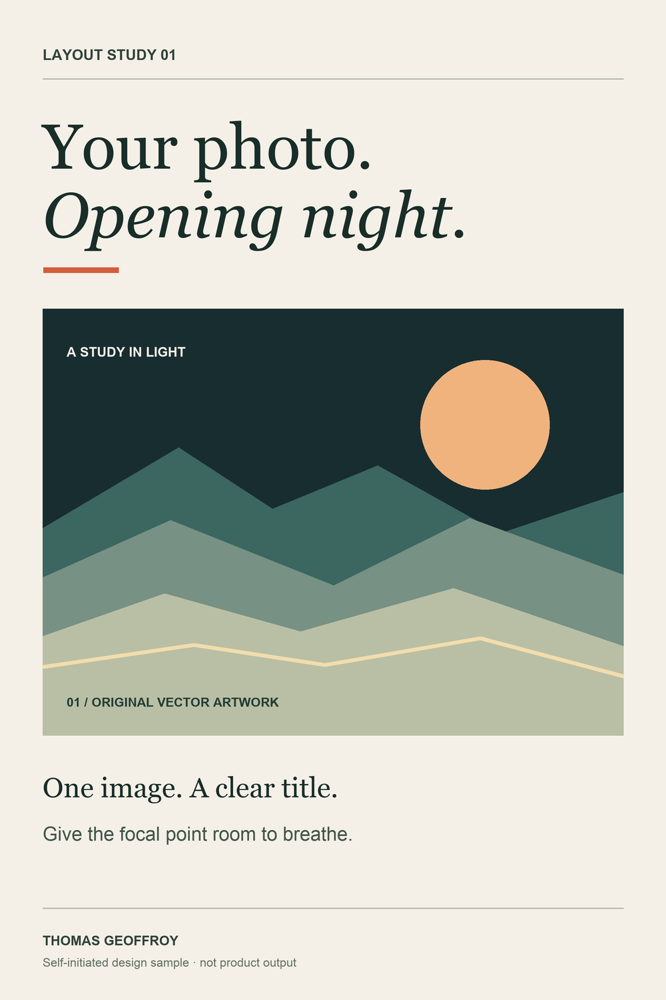
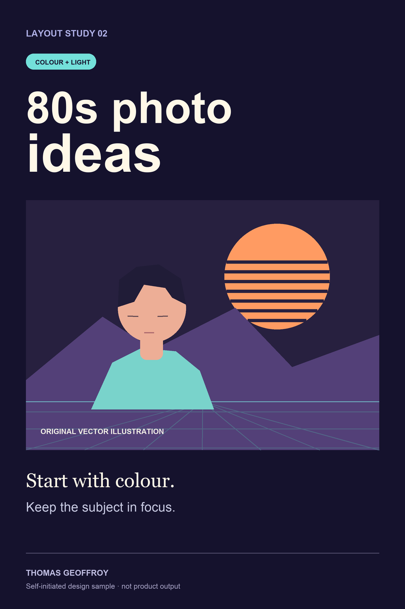

# Two self-initiated Pinterest layout studies

Original vector artwork, typography and layout by Thomas Geoffroy, created 20 October 2026. These are portfolio studies, not prior client work, not photos transformed by Drama Generator, and not evidence of Pinterest campaign performance. No stock photos, product screenshots or trademarked characters are used.

- 01: editorial movie-poster theme; one focal point and spacious text.
- 02: 80s colour theme; high-contrast headline and an intentionally illustrated portrait.

Each file is 1000 × 1500 pixels (2:3). JPGs are final previews; SVG files are editable vector sources with live text. They are not native Figma or Canva documents. The fonts reference Arial and Georgia and do not bundle font software.

For a commissioned pin set, the client's supplied authorised images would replace these illustrations, with titles, descriptions and boards agreed to the actual brief. These previews do not reproduce an output of the client's tool.

## Preview the studies

### Opening night

[Editable SVG](01-opening-night.svg) · [JPG](01-opening-night.jpg)

### Eighties colour

[Editable SVG](02-eighties-colour.svg) · [JPG](02-eighties-colour.jpg)
